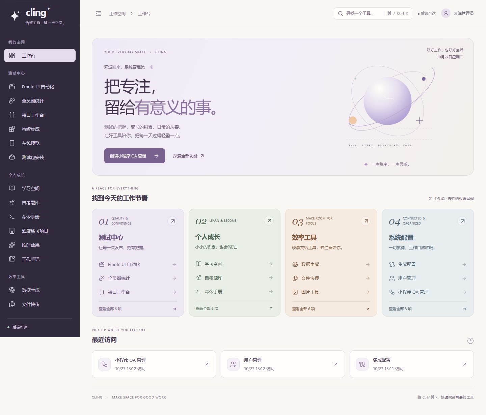
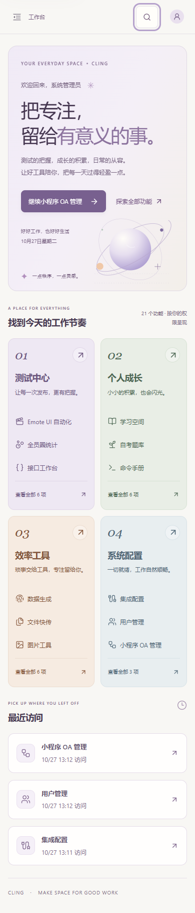
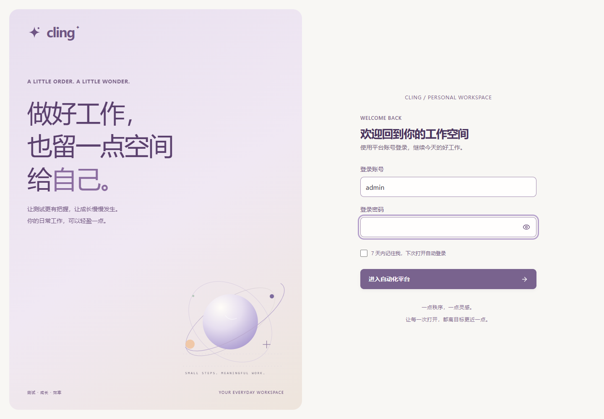
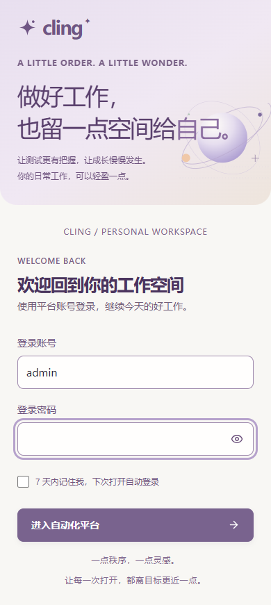
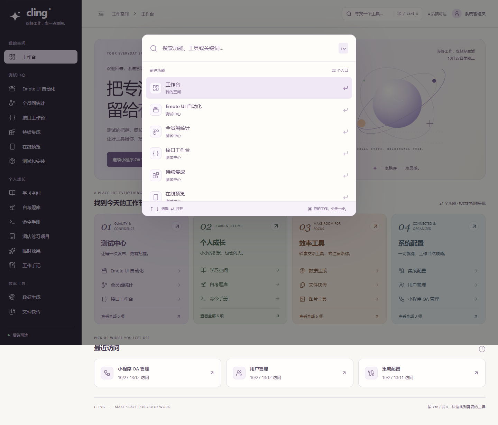
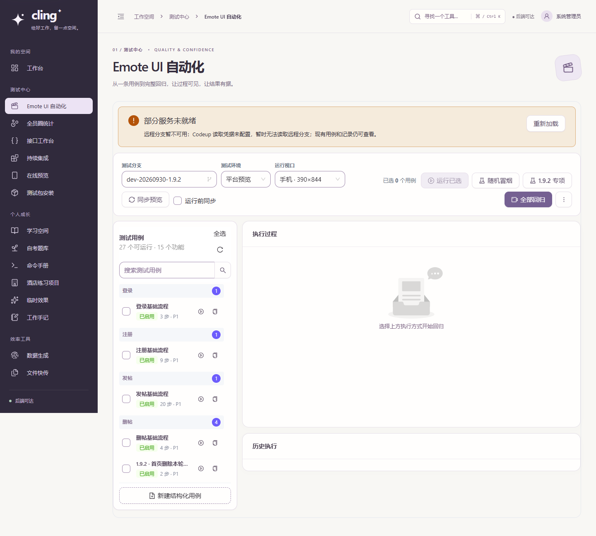
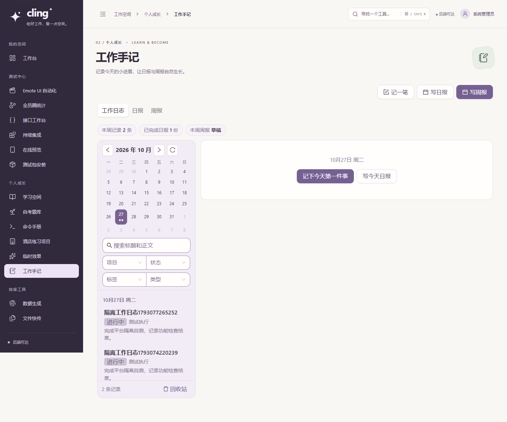
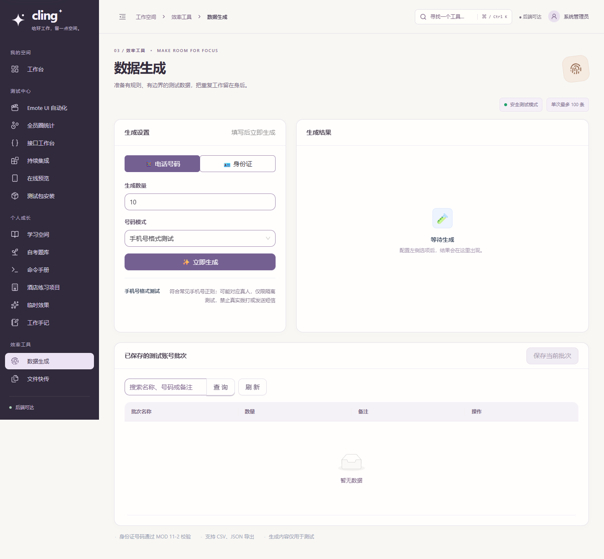

# Cling：轻盈工作空间 · UI 设计与质量审查

日期：2026-10-27。范围：登录、平台框架、工作台，以及测试中心、个人成长、效率工具、系统配置的统一视觉与交互。

## 品质目标与依据

以 Awwwards、Webby、FWA 获奖作品的设计完成度为方向，将目标落到原创视觉、信息结构、操作效率、可读性、响应式和实现质量。**本项目未提交官方评审，自审通过不等于获得这些奖项或得到评委认可。**

[Webby 官方标准](https://www.webbyawards.com/judging-criteria/)包含内容、结构与导航、视觉设计、功能、交互、创新、整体体验。[Awwwards 公开作品评审示例](https://www.awwwards.com/sites/proof-1)体现设计、可用性、创意、内容等维度。本轮不套用无法核实的 FWA 分数或声称取得官方评级。

Cling 是日常工作产品，设计需支持持续使用。保留原生滚动、清晰表单和真实业务反馈；主要通过统一的视觉语言、精细排版、轻量原创图形和更直接的导航提升体验。

## 完成的设计

### 视觉语言

- 暖白底色与深梅紫导航，搭配雾紫、鼠尾草绿、暖桃、灰蓝四个分区色。
- 用一致的线条图标替代导航中分散的 Emoji，保留 Cling 星形标识，形成连贯的身份。
- 原创 SVG 轨道图形用于登录与工作台，支持分辨率变化；没有增加远程字体、视频背景或图形渲染依赖。
- 统一模块编号、页面主标题、说明、图标印记，收拢重复标题。
- 卡片、工具栏、表格、输入框、按钮、状态与焦点层级统一。输入边界和次要文本加强对比，危险与禁用状态保留独立语义。
- 模块业务区保留自己的画布、编辑器、表格和证据尺寸规则，公共视觉样式限定作用域。

### 工作台

- 默认首页改为个人工作台，可继续最近使用的功能，也可按四个工作分区进入。
- 功能数量与入口来自当前账号实际权限，不展示虚构通过率、完成数量或服务状态。
- 最近访问按账号保存于当前浏览器，过滤无权限、重复、损坏及无效时间记录。
- 未分配功能时提供明确说明；导航仍可返回工作台。
- 日期按 Asia/Shanghai 展示，定时更新，关闭组件时清理计时器。

### 导航与功能搜索

- 全局 `Ctrl / ⌘ K` 搜索，支持中文用途与关键词，例如“周报”“API”“图片”。
- 搜索结果来自已授权菜单；按分区浏览也使用同一套入口。
- 支持方向键、回车、Escape；键盘选到列表末项时，保持所选结果可见。
- 搜索弹窗具有可访问名称、组合框与结果列表语义、选择状态和结果数量提示。
- 页面标题随模块变化，浏览器前进后退恢复定位；选择新模块回到页面顶部。
- 手机使用抽屉导航，选择后关闭；主操作和导航触摸目标加大。
- 动效只用于短暂进入与反馈，响应减少动态效果的系统偏好。

## 自审与改进记录

| 轮次 | 发现的问题 | 修订与验证 |
|---|---|---|
| 第一轮：整体构图 | 旧登录样式限制网格宽度、卡片阴影与新体系冲突；顶部搜索受页头行高影响 | 重置继承布局与卡片样式、固定搜索高度；重新检查登录和工作台截图 |
| 第二轮：可读性与层级 | 次要文字偏淡、模块标题重复、手机装饰占用首屏、搜索弹窗缺少可访问名称 | 深化功能文字和输入边界、收拢重复标题、缩小手机装饰区、补上弹窗名称与输入语义 |
| 第三轮：真实交互 | 搜索键盘滚动到末项的坐标计算不正确；损坏的访问时间可能触发格式化异常 | 修正滚动容器坐标；校验日期有效性；增加键盘末项、浏览器历史、账号权限与存储异常回归 |
| 状态复测 | 旧测试脚本只适配首次创建草稿，遇到已有周期与已完成报告时定位失败 | 按实际 409 确认、重新编辑及追加/采纳按钮状态测试，保留报告状态保护；未修改业务校验或放宽断言 |
| 客观诊断 | 首次公开登录页 Lighthouse 桌面结果：性能 89、可访问性 96、最佳实践 100；发现密码显隐按钮只有 15px，静态资源未压缩、未启用 HTTP/2 | 显隐点击区域改为 40×40px，五档显隐与输入保留通过；静态资源 gzip 和 HTTP/2 候选配置通过 Nginx 语法校验，发布后复测 |
| 第四轮：移动端实测 | 压缩后桌面性能 99，但移动端性能 87、最佳实践 96；辅助字号过小，登录页仍加载整个工作框架 | 放大辅助文字，手机隐藏装饰图形内的小字；将登录后框架按需加载。该中间版本移动端性能 84，未视为最终通过 |
| 第五轮：首屏依赖 | 只拆框架仍提前加载较多组件库代码 | 登录表单改用轻量原生控件，完整组件库移至登录后加载；保留记住登录、会话恢复、密码显隐和错误恢复。最终桌面性能 100、移动端 97，可访问性及最佳实践均为 100 |

检查了代表性文本/背景配对：四个分区文字对软背景约 **5.2–5.5:1**，工作台说明约 **4.7:1**，输入边界对浅色输入背景约 **3.1:1**。这些是局部配对验证，**不等同于完整 WCAG 认证**。

## 验证结果

使用排除原有未提交功能的独立发布副本构建，业务写入仅发生于独立 SQLite 和隔离附件目录。

| 验证 | 结果 |
|---|---|
| 正式前端构建 | 通过 |
| 前端逻辑回归 | 8 组通过，覆盖请求、评分、组卷、存储与新增工作台目录 |
| 原有核心业务流程 | 16 组通过，覆盖批次、图片、文件、JSON、转码、接口、人员、笔记、工作日志→日报→P/R/O 周报、用例、数据集、测试包、预览、集成 |
| 异常流程 | 4 组通过：采集失败与中断恢复、下载内容、权限 403、图片请求 401 |
| 新增工作台交互 | 9 组通过：搜索/键盘、末项滚动、访问记录恢复、前进后退、手机导航、减少动效、权限过滤等 |
| 自考实际页面 | 双账号隔离、31 题组卷、旧进度归属及副本保留通过 |
| 有数据的测试中心 | 32 条用例、历史执行、长分支与网址的五档布局通过；用例区独立滚动 |
| 模块布局 | 22 个模块 × 5 档 = 110 个组合，无整页横向溢出、无未处理页面异常 |
| 登录布局 | 1440、1280、768、390、320px 通过 |
| 轻量登录与恢复 | 6 项通过；另验证记住登录的持久存储与刷新恢复、3 个独立公开入口 |
| 登录异常 | 模拟 503 可见反馈、输入保留、记住选项传递、重复点击只发一次请求、失败后可重试均通过 |
| 密码显隐 | 五档 40×40px 点击区，显示/隐藏切换和输入保留通过 |
| 最终线上冒烟 | 22 模块 × 5 档通过；21 个核心读取接口均 200，无认证用户接口 401；会话存储恢复及记住选项保留 |

本轮没有修改后端业务代码、数据库或 Emote 独立项目，不把上一轮 123 项后端结果算作本轮新执行的测试。真实钉钉写表、Jenkins 发布、Emote 已有业务问题、微信真机登录等仍遵循前一轮专项边界，不能由 UI 或模拟测试代替真实验收。

本轮仍需外部验证的品质维度包括真实用户任务效率、真机/跨浏览器细节及真实用户性能。Lighthouse 只检查公开登录页的实验室表现，不代表全部登录后功能或真实用户指标；没有编造用户访谈或奖项评分。

## 最终线上性能

对 `https://xiaomeiqaq.top/` 公开登录页运行 Lighthouse，最终发布版本为 `86cdd59`。以下为实际单次实验室采样，保留中间下降结果，未挑选多次运行中的最高分。网络与设备负载变化可能影响复测。

| 采样阶段 | 性能 | 可访问性 | 最佳实践 |
|---|---:|---:|---:|
| 桌面，首次诊断 | 89 | 96 | 100 |
| 桌面，压缩及 HTTP/2 | 99 | 100 | 100 |
| 手机，压缩版本 | 87 | 100 | 96 |
| 手机，仅拆分工作框架 | 84 | 100 | 100 |
| 桌面，最终轻量登录 | **100** | **100** | **100** |
| 手机，最终轻量登录 | **97** | **100** | **100** |

最终桌面 FCP/LCP 约 0.3s、TBT 20ms；手机 FCP 1.3s、LCP 1.4s、TBT 190ms；两种模式 CLS 均为 0。仍有未用 JavaScript、强制布局与依赖链诊断提示，100 分不代表不存在改进空间。

HTML 直接引用的静态入口资源，从初次诊断的 9 个、873,970 字节，降到 2 个、82,349 字节（约减少 90.6%）。这是入口资源响应体大小，**不包含登录后按需下载的完整资源总量**。普通登录页不提前请求工作台组件；登录、已有会话和公开独立页面仍按各自入口正常进入。

原始摘要、采样时间、版本及接口结果见 [品质验证数据](assets/ui-atelier-20261027/quality-evidence.json)，线上逐模块宽度记录见 [线上布局结果](assets/ui-atelier-20261027/production-layout-results.json)。

## 发布范围

- 新增工作台、目录元数据、品牌图形、搜索与独立样式文件，调整主框架和登录页展示。
- 保留线上已有的登录记忆、审批记账与全员圈能力；只暂存本轮设计修改，不覆盖其他未提交工作。
- 仅更新前端服务；更新前备份源码与前端镜像，提供回退。
- 已推送并部署 `86cdd59`，仅更新前端容器；Nginx 语法与容器健康检查通过，未重启后端或执行器。
- 最终更新前的源码、前端镜像备份：`/opt/cling-backups/86cdd59-20261027T052052Z`。最初更新前的备份：`/opt/cling-backups/35021fe-20261027T042629Z`。
- 访问：[HTTPS 平台](https://xiaomeiqaq.top/)，原 IP 入口继续可用。当前已有页面会显示更新提示，由用户主动刷新，不丢弃未提交输入。
- 线上验证只读核心资源；写入类验证使用本机隔离数据或模拟服务。服务器临时浏览器会话已清理，不导出账号密码或 Token。

## 代表性界面

以下截图来自隔离环境，示例记录不是生产数据。

