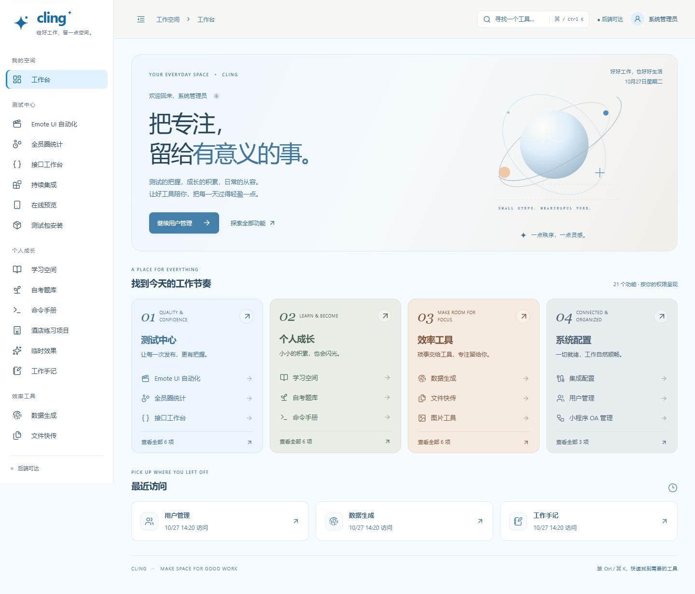
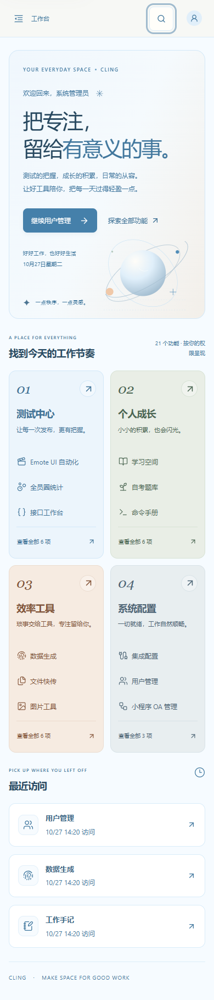
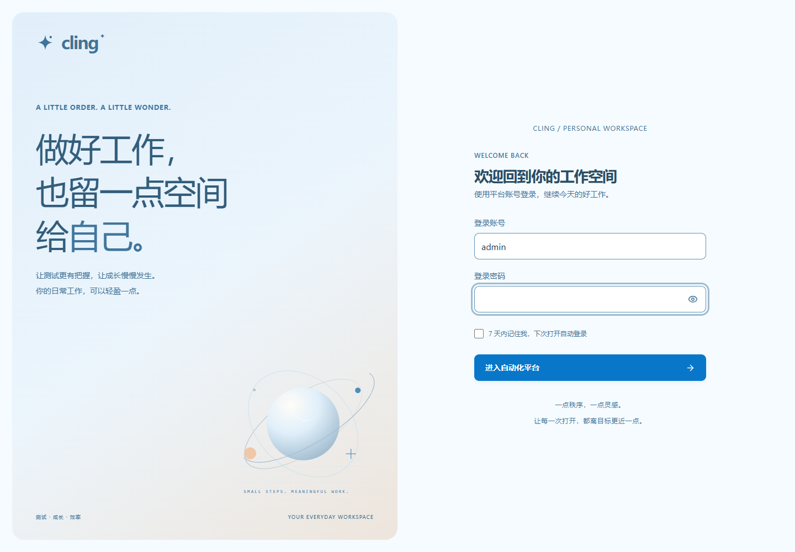
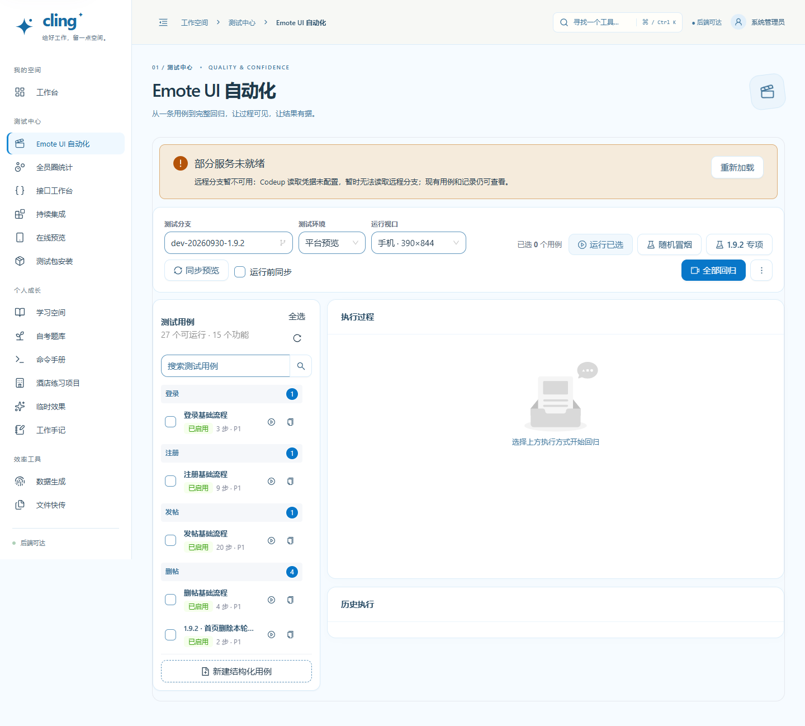

# Cling 晴空蓝主题

已部署版本：`65eadb0`。访问：[Cling](https://xiaomeiqaq.top/)。

针对原主题偏暗、深紫侧栏占据较大视觉重量的问题，将整体改成明亮的晴空蓝主题：

- 导航从深紫改为白色，以浅蓝选中背景、蓝色竖线明确当前位置。
- 页面背景改为冰蓝白，卡片与表单使用白色，减少大片灰紫底色。
- 主色为 `#0877c9`，统一按钮、焦点、搜索、图标及自动化功能计数。
- 登录和工作台的图形同步调整为蓝色，保留薄荷绿、暖杏色分区点缀。
- 文字与输入边界单独加强对比；成功、警告、失败继续保留独立语义颜色。

本轮只改主题、组件颜色与装饰图形，没有修改业务接口或流程。

## 验证

| 检查 | 结果 |
|---|---|
| 前端生产构建 | 本机与服务器均通过 |
| 搜索、键盘、访问历史、权限过滤、手机导航 | 9 项通过 |
| 本机模块布局 | 22 模块 × 5 档宽度，无整页横向溢出、无未处理页面异常 |
| 登录页布局 | 1440、1280、768、390、320px 通过 |
| 线上只读检查 | 22 模块 × 5 档通过；白色侧栏生效、搜索和会话恢复正常 |
| 公开登录页 Lighthouse | 可访问性 100、最佳实践 100；本轮没有重新测性能分数 |

Lighthouse 是公开登录页的自动化检查，不等同于全平台 WCAG 认证。截图来自本机隔离数据。

只更新前端服务，源码及镜像备份：`/opt/cling-backups/65eadb0-20261027T062257Z`。服务器临时测试会话在验证后清理。

## 界面

