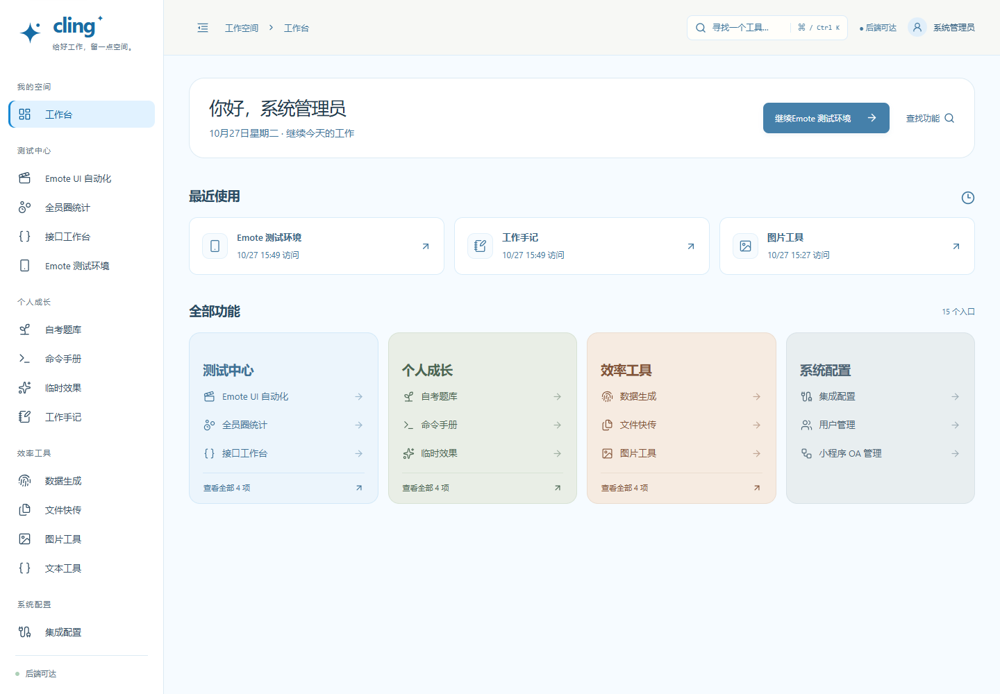
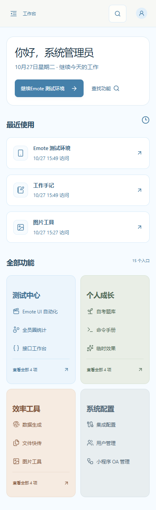
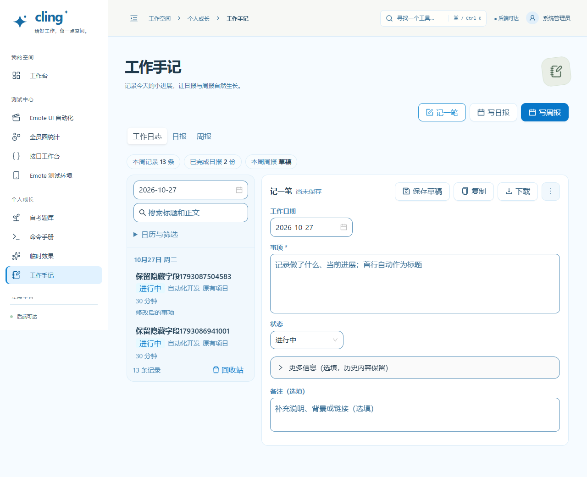
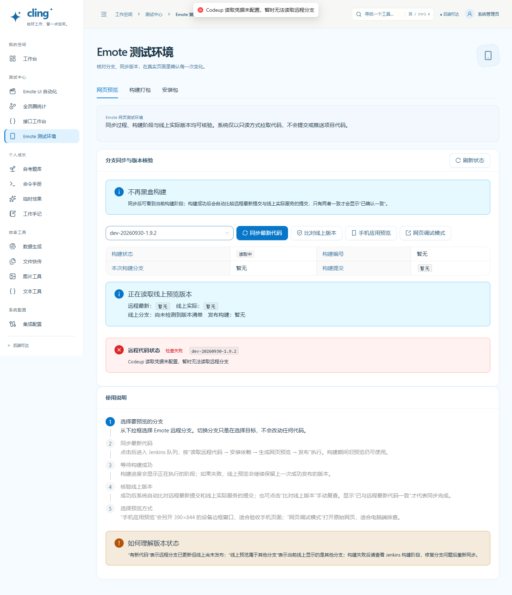

# Cling 模块清理与工作空间精简

发布版本：`6599951`。访问：[Cling](https://xiaomeiqaq.top/)。

## 完成范围

1. 移除整个学习空间：旧学习页、新关卡页、课程和答案、笔记专属接口、导入逻辑、权限项、模型及初始化迁移。自考题库继续保留。
2. 移除酒店练习项目：前后端页面、模型、接口、API 工作台的 Booker 快捷卡片、配置与 Nginx 代理。专属容器和目录在备份后下线。
3. 移除莓好审批网页版及 Web 端记账组件，保留小程序 OA 管理和小程序共用后端。
4. 删除未调用的参数化玫瑰动画实现，保留实际使用的动画和临时效果上传、预览、分享。
5. 去掉旧编辑器依赖及 13 个 npm 安装包，移除只供旧学习导入使用的 bleach、markdownify 后端依赖。
6. 清除 90 条被覆盖的样式声明、下线模块样式；颜色归到 `theme.css`，布局、公共组件与品牌规则分工保留。
7. 首页压缩欢迎区，最近使用前置，减少英文口号、装饰和重复入口；模块标题也减少装饰信息。
8. 日志默认只展示工作日期、事项、状态和备注；项目、工时、标签、结果、风险和下一步折叠保留。首行生成新日志标题，旧日志字段不会因编辑事项而丢失。
9. 日历和筛选默认折叠，修复低高度桌面窗口中筛选区遮住日志列表、记录无法点击的问题。
10. 预览、构建和安装包合并为“Emote 测试环境”；JSON 和转码合并为“文本工具”。原权限独立，旧 `?module=` 地址保留，受限账号不会获得额外页签。

主功能入口从 21 个收敛至 15 个（不含工作台）；内部保留 18 个功能视图，共 19 个含首页的视图用于布局检查。

## 验证结果

| 检查 | 结果 |
|---|---|
| 准确发布副本的生产构建 | 通过 |
| 准确发布副本的后端测试 | 109 项通过 |
| 前端逻辑测试 | 9 组通过，包括分组导航权限、请求、评分、组卷和进度 |
| 本机业务流程 | 15 项通过，包括日志→日报→周报、自考账号隔离、文件、图片、文本、用户、接口、用例、数据集、包、效果、集成、OA 人员等 |
| 异常流程 | 4 项通过，覆盖 401、403、采集中断、下载内容 |
| 工作台交互 | 9 项通过，覆盖搜索、键盘、前进后退、访问记录、损坏存储、手机导航和受限账号 |
| 本轮专项 | 下线接口 404、组合入口兼容、子页签权限隔离、日志隐藏字段保留均通过 |
| 线上只读冒烟 | 20 个核心读取接口正常；无认证访问用户接口为 401 |
| 线上布局 | 19 视图 × 5 档宽度 = 95 个组合，无页面异常与整页横向溢出 |

截图来自本机隔离数据。写入操作只在本机测试；没有在生产上触发真实 Jenkins 构建、钉钉写表或 Emote 业务写入。旧功能的专属测试随模块移除，并增加了接口、权限与新数据库不再建旧表的下线测试。

## 发布和数据边界

- 仅更新平台后端和前端；其他执行器和独立 Emote 项目保留。
- 数据库、源码、镜像、学习附件的发布前备份：`/opt/cling-backups/6599951-20261027T075719Z`。
- 酒店独立项目源码及镜像也在同一备份目录归档；原 `/opt/restful-booker` 不再作为运行目录。
- 酒店、莓好审批和 Booker 独立地址返回 410；学习与酒店专属 API 不再挂载，返回 404。
- **历史数据库记录和学习附件保留在原表/存储及备份中，没有永久销毁；应用不再展示或继续写入这些模块。**
- 已有账号的下线权限在菜单和用户管理返回值中过滤；不自动授予其他权限。
- 工作区已有认证、OA、小程序和全员圈改动未混入本轮提交。删除前的本地源文件（包括未提交 Web 页）保存在忽略目录 `output/cleanup-20261027/source-before.zip`。

## 代表性界面

