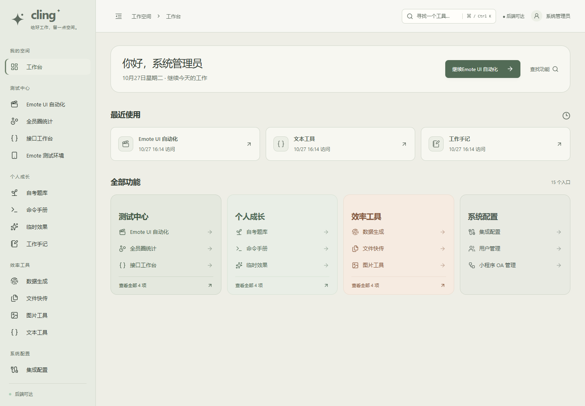
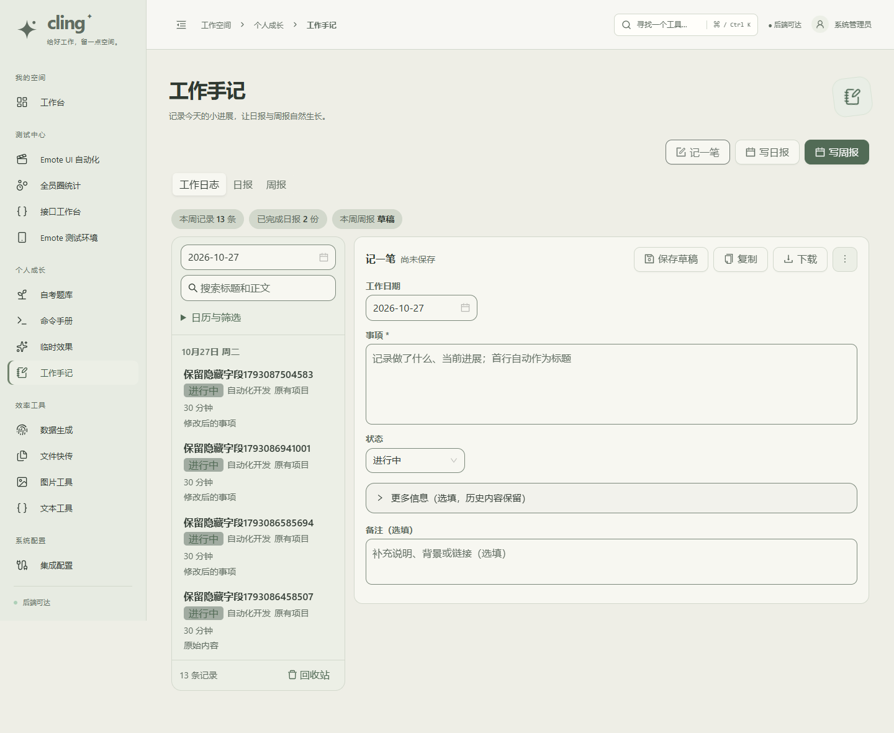

# Cling 舒缓绿主题

发布版本：`503230b`。已部署：[Cling](https://xiaomeiqaq.top/)。

根据使用反馈，移除大面积浅蓝和饱和蓝色文字，改为暖米灰页面、柔和米白卡片、灰黑正文和低饱和鼠尾草绿按钮。导航也使用浅灰绿，减少纯白与彩色文字形成的刺激感；错误、警告和成功仍保留明确状态颜色。

本轮只调整配色与装饰图形，不更改业务流程。

## 检查

- 前端生产构建通过；首页、工作日志、文本工具、UI 自动化覆盖 1440、1280、768、390、320px，共 20 个布局组合通过，无整页横向溢出和页面异常。
- 代表性对比度：正文 10.13:1、辅助文字 4.72:1、按钮 5.84:1、输入边界 3.41:1，两类分类卡片文字大于 6:1。局部配对验证不等同于全平台无障碍认证。
- 只更新前端服务，健康与 Nginx 配置检查通过。更新前备份：`/opt/cling-backups/503230b-20261027T081748Z`。
- 线上公开登录页 Lighthouse：可访问性 100、最佳实践 100；本轮未重新测量性能分数。

