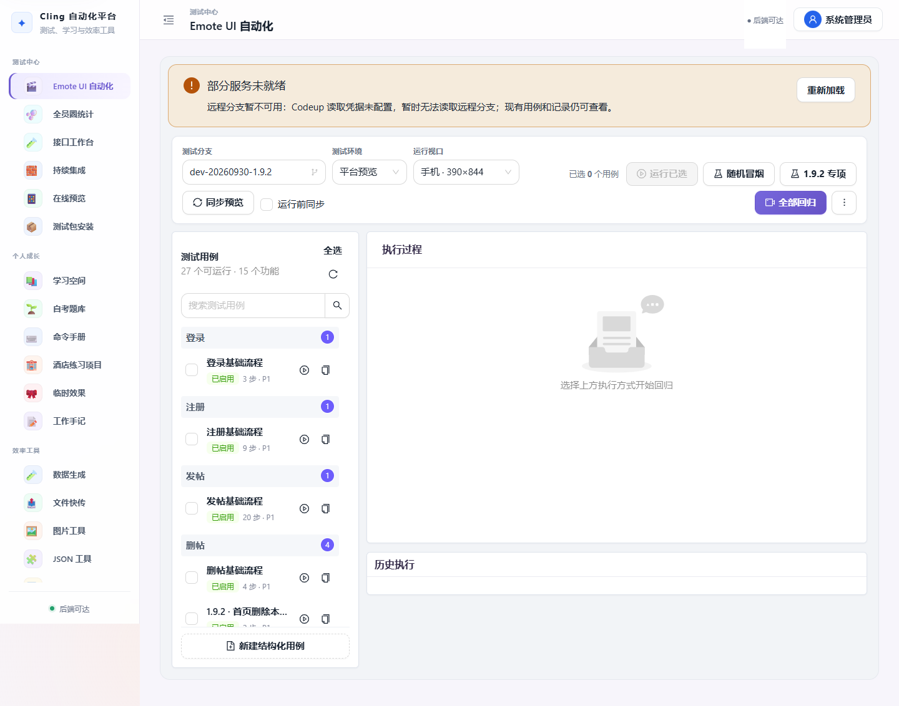
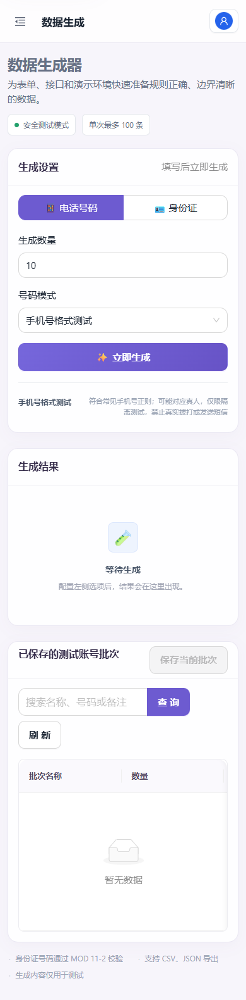

# Cling 全平台优化与自测报告

日期：2026-10-26。范围：测试中心、个人成长、效率工具、系统配置。

## 结论

本轮已完成跨模块公共交互修复及主要流程回归。仅含本轮改动的干净发布副本：后端 **123 项通过**，前端逻辑 **7 组通过**，正式构建通过；浏览器 **16 组核心流程、4 组异常流程及双账号进度检查通过**。21 个模块在五种宽度下检查，无整页横向溢出、无未处理页面异常。

**不能据此宣称所有真实外部业务链路全部通过。** 钉钉扫码与在线表格图片对应、真实 Jenkins 发布、Emote 业务服务的已有失败，需要各自验收；模拟响应只验证平台交互。每个按钮能渲染或页面能打开，也不等于对应业务通过。

## 本轮修复

### 公共界面与请求

- 保留柔和紫色、圆角，统一卡片、标题、标签、焦点反馈，正文字号提高到 15px。
- 修复手机抽屉导航下内容仍保留侧栏偏移、JSON 面板撑破页面、工具栏和长链接溢出；表格只在自身区域滚动。
- 手机主要操作至少 44px；修复账号按钮头像被隐藏，减少生成器和图片区域空白。
- 将接口工作台、持续集成、在线预览、测试包安装归入测试中心，原 URL 和权限键保持兼容。
- Ant Design 内置提示、日期与确认操作统一中文；支持键盘跳到主要内容。
- 统一 401、403、404、429、5xx、断网、取消、超时、非法响应反馈；422 能显示字段原因，5xx 保留响应 request-id。
- 读取默认 20 秒，写入 90 秒，上传下载 120 秒；写入不自动重试，超时先核对记录。
- HTTP 部署中的复制操作统一采用兼容方式，涉及 JSON、转码、文件、测试包、接口、Jenkins、莓好审批。
- 集成配置加载失败不再污染登录状态；退出后的旧请求不能更新当前账号状态；连接灯随真实健康请求变化。
- 模块异常提供重试及主动刷新入口，不强制刷新未保存输入。

### 测试中心

- Codeup 分支不可达时仍展示已成功读取的用例、数据集和历史记录，失败部分可重试。
- 用例编辑和数据集等表单使用独立名称，修复多个隐藏表单同名字段导致标签指向错误的问题。
- 新建用例等待功能列表就绪；保存增加重复点击保护；新增用例删除确认，保留历史证据。
- 数据集删除增加确认和失败反馈，复制用例失败可见；历史用例删除后仍可按执行摘要展示证据。
- 用例编辑布局、工具栏与嵌入区域随容器收缩。
- 在线预览缺少 Codeup 配置时明确返回 503；Git 输出使用 UTF-8，空或异常版本信息返回明确 502，避免解码异常造成 500。
- 全员圈采集、轮询、二维码读取、写入错误可见；提供重新查询和最后成功查询时间。
- 全员圈按登录账号保存最近任务，重新进入后查询恢复；重启时仅明确 prepared/completed 的计划恢复为对应状态，其余标记执行中断并禁止直接写入。

### 个人成长、效率与配置

- 修复自考使用不存在的用户编号导致本机进度共用的问题，按登录账号隔离并重新挂载组件。
- 旧版进度不自动归属新账号，确认本人后导入，原始副本保留；已归属其他账号的旧进度不能再次认领。
- 回归主观题作答、AI 参考评分、人工改分、只读回看、补答、刷新恢复及过期响应保护。
- 学习笔记回归新增、保存、目录折叠、删除；编辑与章节内容的服务端回归由现有测试覆盖。
- 工作手记来源预览失败会清除旧预览并显示错误，避免采纳上一次结果；日志→日报→P/R/O 周报链路通过。
- 图片生成与处理下载接入统一请求，修复登录失效时调用未定义方法的问题。
- Hex 严格检查非法字符、奇数长度和无效 UTF-8；未知转换类型报错；JSON 差异支持原型同名键。
- 接口新增表单清除上一条 URL 等残留；用户编辑清除旧密码；集成配置测试时禁用按钮，避免重复通知。

## 验证记录

所有业务写入均使用独立 SQLite、隔离附件目录和测试账号。没有采集真实钉钉帖子、写入在线表格、向好友发消息、触发生产构建或申请注销。

| 模块 | 已验证内容 | 结论/边界 |
|---|---|---|
| Emote UI 自动化 | 查看、新增、编辑、复制、删除用例；数据集保存和删除确认；专项入口与敏感授权 | 平台流程通过；真实 Emote 执行另验 |
| 全员圈统计 | 503 可见、任务恢复、中断禁写；6 项恢复分类测试 | 隔离通过；真实扫码和表格图片未验 |
| 接口工作台 | 记录、新建不继承 URL；API 数据模型回归 | 通过；外部接口可用性不在此结论内 |
| 持续集成 | 加载、状态错误提示、示例复制、五档布局 | 不触发真实构建发布 |
| 在线预览 | 未配置/非法版本错误、布局、恢复入口；7 项后端测试 | 不改变或发布 Emote 源码 |
| 测试包安装 | ZIP 上传、固定链接复制、实际下载 HTTP 200 且有内容 | 通过；未验证真机安装 |
| 学习空间 | 笔记新增、保存、目录折叠、删除；原有学习服务测试 | 通过；不以此声称人工逐条审定所有教学答案 |
| 自考题库 | 31 题组卷、100 分制、押题比例、双账号隔离、旧进度归属、AI/人工评分、回看、补答 | 通过；本轮 AI 提供方使用模拟 |
| 工作手记 | 日志保存、日志汇总日报、日报生成 P/R/O 周报 | 通过 |
| 命令手册 | 新增、复制、收藏、编辑、删除 | 通过 |
| 酒店练习项目 | 房间/预约服务端回归、页面与五档布局 | 本机外部 Booker 不可达，真实预约链路未验 |
| 临时效果 | ZIP 上传、iframe 中实际展示内容、删除本轮效果 | 通过 |
| 数据生成 | 生成、保存批次、备注、读取、修改、删除；号码正则与风险标记 | 通过；号码不保证未分配给真人，不用于发送短信 |
| 文件快传 | 上传、复制、二维码、真实下载内容一致、删除 | 通过 |
| 图片工具 | 生成下载、上传处理下载、401 恢复登录 | 通过 |
| JSON 工具 | 格式化、压缩、差异、HTTP 复制降级、特殊属性键 | 通过 |
| 转码工具 | 执行、复制、互换；Unicode 编解码往返和非法输入 | 通过 |
| 莓好审批网页版 | 登录页面与布局、复制；真实审批路由+数据库提交审核及重复审核保护 | 审批服务通过；微信登录需微信环境 |
| 集成配置 | 新增、修改、删除、模拟测试通知、重复点击保护 | 通过；未投递真实消息 |
| 用户管理 | 新增、修改、密码清空、删除；受限账号菜单与 403 | 通过 |
| 小程序 OA 管理 | 人员新增、编辑、禁用、删除 | 通过；小程序真机另验 |

布局：21 × 5 = **105 个模块/宽度组合**（1440、1280、768、390、320px），检查文档滚动宽度和页面异常。用例和接口弹窗已在实际操作中检查；不代表任意历史超长内容都已穷举。

后端 123 项全部通过；前端 7 组 Node 测试通过，包含随机组卷 100 轮与评分边界。现有 datetime.utcnow 弃用警告仍存在，本轮不做涉及历史时间语义的全库替换。

## 剩余真实依赖与后续顺序

1. Emote 1.9.2 的已有真实专项记录为 6 通过、6 失败、4 阻断，**本轮没有重跑并把它改记为通过**。昵称契约、删除后列表、备注接口及举报弹窗等需由业务端修复后复测；详见此前专项报告。
2. 钉钉在专用测试表中验收扫码、图片/描述/提出人逐行一致、写入后的实际图片类型；本轮仅修复任务反馈与恢复，未改变图片判定算法。
3. Jenkins 分支同步、构建、APK 下载/安装需专用任务与设备；平台读取健康状态不能证明构建成功。
4. 正式 DeepSeek、微信、外部接口受各自账号与服务状态影响，不以模拟通过代替真实验收。

## 复现与发布

- 浏览器脚本与隔离环境说明：`frontend/tests/platform-audit/README.md`。
- 后端：`PYTHONPATH=backend python -m pytest backend/tests -q`。
- 前端：`npm run build`；对 src 内全部 `*.test.mjs` 执行 `node --test`。
- 发布仅包含本轮暂存改动；原有登录记忆、快捷记账、全员圈 AI、独立 Emote 等未提交内容保留在工作区，没有混入本次发布。
- 远程先备份源码、数据库及受影响镜像，确认自动化/采集/Jenkins 空闲，再更新受影响服务；失败恢复上一版本。
- 最终部署版本及外网验收结果在发布完成后追加。

## 代表性界面

